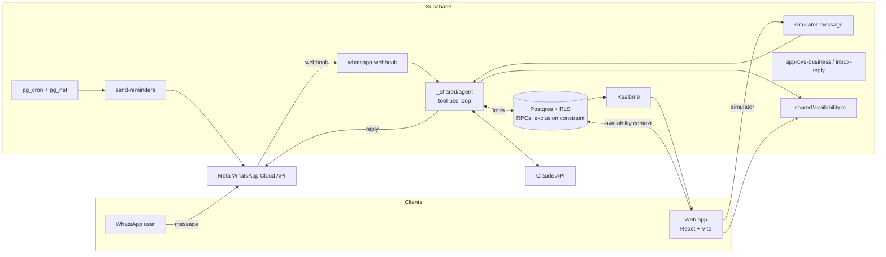

# BookFlow AI

**Multi-business booking SaaS with an AI agent that takes appointments 24/7 on WhatsApp.**
Barbershops, salons, clinics and spas get a WhatsApp assistant that answers questions, checks real availability, books, reminds and reschedules appointments, plus a dashboard with a live calendar.

> Portfolio project · React + TypeScript + Supabase + Claude

<!-- Screenshots / GIF: add docs/screenshots/*.png and docs/screenshots/whatsapp-flow.gif -->

|                         |                                                                                                     |
| ----------------------- | --------------------------------------------------------------------------------------------------- |
| **Live demo**           | _set after deploy_ (`https://<your-app>.vercel.app`)                                                |
| **Demo accounts**       | `admin@bookflow.demo` (super admin) · `owner@donpepe.demo` (owner) · `barbero@donpepe.demo` (staff) |
| **Demo password**       | `BookFlow2026!` (demo data only)                                                                    |
| **Try it in 2 minutes** | Sign in as the owner → **Simulator** → "Hola DONPEPE, quiero un corte mañana" → open **Calendar**   |

## Features

- **AI agent on WhatsApp** (LLM with tool use: Google Gemini on the free tier or Claude, switchable with one env var): answers FAQs from the business knowledge base, offers only real free slots, books, lists, reschedules and cancels, and hands off to a human for complaints or medical questions. Replies in the customer's language (ES/EN).
- **One number for every business**: customers write `Hola DONPEPE` (the business booking code, via a `wa.me` link or QR); the agent routes the chat to that business.
- **Built-in WhatsApp simulator**: the same pipeline as WhatsApp, so anyone can try the bot without Meta credentials. Bookings appear in the calendar in real time.
- **Business dashboard**: KPIs, 30-day chart, FullCalendar agenda per staff with drag-to-reschedule, bookings table with CSV export, customers with history and total spent, inbox with tool calls and manual takeover.
- **Multi-tenant onboarding**: owners apply, the super admin approves (welcome email via Resend), then a 4-step setup: services, staff, hours, knowledge base → `wa.me` link and QR.
- **Public booking page** `/b/:slug` (4 steps) and customer portal `/me` with phone OTP.
- **Reminders** 24 h and 2 h before, sent by `pg_cron` through the active provider (WhatsApp template or simulator).
- **Roles**: super admin, owner, staff (own agenda only), customer, all enforced with Postgres RLS.
- ES/EN, dark mode, responsive from 360 px, empty states, skeletons, toasts and confirmations.

## Architecture



- **Availability lives in one module** (`supabase/functions/_shared/availability.ts`) used by the agent, the public page and the dashboard. The database revalidates every write (`validate_slot`) and a `btree_gist` exclusion constraint makes double booking impossible, even with simultaneous requests.
- **The agent never invents times or prices**: it can only offer what `find_available_slots` returns. Max 5 tool calls per turn, 25 s timeout, 30 messages/hour per phone, idempotent on `provider_message_id`, and any model error becomes an apology plus a human handoff.
- **Messaging is behind an interface** (`MessagingProvider`): `simulator` (default) or `whatsapp`, switched with `MESSAGING_PROVIDER`.

## Tech stack

React 18, Vite, TypeScript (strict), Tailwind, shadcn/ui-style components, React Router, TanStack Query, React Hook Form + Zod, FullCalendar, Recharts, i18next · Supabase (Postgres, RLS, Auth, Realtime, Storage, Edge Functions on Deno, pg_cron, pg_net) · Gemini API (`gemini-3.5-flash-lite`, free tier) or Claude API (`claude-sonnet-5-5`), tool use · WhatsApp Cloud API · Resend · Vercel · Vitest, PGlite, Playwright, GitHub Actions.

## Project structure

```
apps/web/                 React app (routes per role, features, UI kit, i18n)
supabase/migrations/      Schema, RLS, RPCs, cron
supabase/seed.sql         Demo data (2 businesses, 40 bookings, demo accounts)
supabase/functions/       Edge Functions + _shared (agent, messaging, availability, reminders)
supabase/tests/           RLS tests (Vitest + PGlite, and pgTAP)
e2e/                      Playwright flow
docs/                     PLAN, DECISIONS, CASE_STUDY
```

## Run locally

```bash
npm install
cp .env.example apps/web/.env.local   # set VITE_SUPABASE_URL / VITE_SUPABASE_ANON_KEY
npm run dev                            # http://localhost:5173
```

Backend (Supabase CLI + Docker):

```bash
supabase start            # applies migrations and seed.sql
supabase functions serve  # Edge Functions, reads supabase/.env
supabase secrets set ANTHROPIC_API_KEY=... CRON_SECRET=... APP_URL=...
```

Quality:

```bash
npm run lint && npm run typecheck && npm test   # 55 tests: availability, agent (Claude mocked), RLS, reminders, providers
E2E_BASE_URL=https://... E2E_PASSWORD=... npm run e2e
```

The DB tests run the real migrations and seed on [PGlite](https://pglite.dev) (Postgres in WASM) with a minimal Supabase `auth` stub, so RLS and RPCs are tested in CI without Docker. The agent tests run the full pipeline (routing → Claude mock → tools → SQL RPCs) on that same database.

## Environment variables

See [`.env.example`](.env.example). Web: `VITE_SUPABASE_URL`, `VITE_SUPABASE_ANON_KEY`, `VITE_WHATSAPP_NUMBER`, `VITE_DEMO_MODE`, `VITE_DEMO_PASSWORD`. Edge Functions: `LLM_PROVIDER`, `GEMINI_API_KEY` / `GEMINI_MODEL` or `ANTHROPIC_API_KEY` / `CLAUDE_MODEL`, `MESSAGING_PROVIDER`, `WHATSAPP_*`, `RESEND_API_KEY`, `CRON_SECRET`, `APP_URL`.

## Connecting WhatsApp

1. Create a Business app at developers.facebook.com and add the WhatsApp product.
2. Copy the test number's `PHONE_NUMBER_ID` and create a permanent token with a System User.
3. Add your phone as a test recipient.
4. Webhook URL `https://<project>.supabase.co/functions/v1/whatsapp-webhook`, verify token = `WHATSAPP_VERIFY_TOKEN`, subscribe to `messages`.
5. Create the Utility templates `booking_reminder` and `booking_confirmation` (body with 4 variables: name, service, date, business).
6. `supabase secrets set WHATSAPP_TOKEN=... WHATSAPP_PHONE_NUMBER_ID=... WHATSAPP_VERIFY_TOKEN=... WHATSAPP_APP_SECRET=... MESSAGING_PROVIDER=whatsapp`

## Roadmap

- Stripe Checkout deposits (schema already supports `pending_payment` and its 15-minute expiry)
- Dedicated WhatsApp number per business, multi-location

See [docs/DECISIONS.md](docs/DECISIONS.md) for trade-offs and [docs/CASE_STUDY.md](docs/CASE_STUDY.md) for the write-up.
